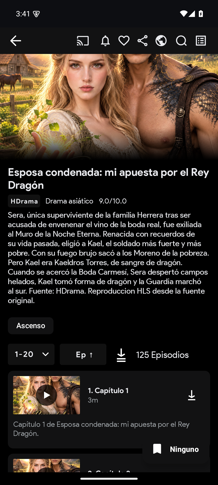
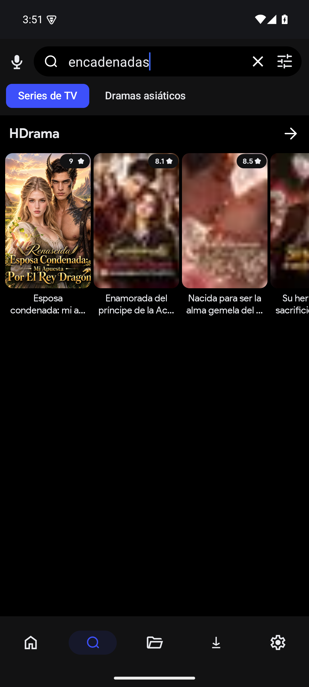

# HDramaCloudStream

Extensión de [CloudStream](https://github.com/recloudstream/cloudstream) para
[es.hdrama.net](https://es.hdrama.net/), escrita en Kotlin.

**Estado:** versión 3 (release de referencia v1.2.0), beta. El catálogo, la
búsqueda, las fichas, los episodios y el video HLS se obtienen del sitio real.
La versión 3 reescribe la capa de red: el Cloudflare Managed Challenge se
resuelve **una sola vez** en un WebView y todas las peticiones (HTML y API) se
hacen después por OkHttp con la cookie `cf_clearance`, el User-Agent del WebView
y `Referer: https://es.hdrama.net/`. El resultado son URLs HLS directas, sin
proxy ni cabeceras, que ExoPlayer reproduce y CloudStream puede descargar.

## Qué funciona

| Función | Estado |
|---|---|
| Plugin `.cs3` y registro del proveedor HDrama | Implementado; carga verificada en CloudStream 4.9.1 |
| Secciones: Destacados, Novedades, Más vistos, Tendencias, Catálogo general, Géneros, Fuentes y Acceso | Implementadas con el HTML real |
| Búsqueda real (`/search?q=`) | Implementada |
| Ficha real: póster, sinopsis, géneros, nota, año y relacionadas | Implementada |
| Lista completa de episodios con duración y número mostrado | Implementada |
| Sesión Cloudflare | Resuelta una vez por proceso (`WebViewCloudflareSession`) y warm-up al cargar el plugin |
| Fuentes de video: HLS directo desde la URL descifrada | Implementado; sin proxy ni cabeceras |
| Comprobación de enlaces de video (`SourceProbe`) | Implementado; descarta URLs muertas antes de entregarlas al player |
| Reproducción HLS en ExoPlayer | Implementada con enlace `ExtractorLinkType.M3U8` directo |
| Descarga desde CloudStream | Implementada; CloudStream descarga el HLS y concatena los segmentos en un MP4 |
| Descifrado AES-256-GCM del payload `/api/episode-source` | Implementado y probado con vectores, incluida la fuente Stardust |
| Respaldo por sitemaps y fichas de navegación sin sesión | Implementado |
| Catálogo demo con MP4/HLS públicos ("Acceso a HDrama") | Implementado |
| Estados de error diferenciados y mensajes en español | Implementado |
| Subtítulos | Soportados si la fuente los aporta |
| Favoritos, historial, continuar viendo y pantalla completa | Nativos de CloudStream |
| Pruebas unitarias JVM | 117 pruebas unitarias en 18 suites |

## Capturas

Capturas de la verificación de la versión 3 (emulador Android 15 +
CloudStream 4.9.1): ficha real con 125 episodios, reproducción HLS real
(`Rendered first frame`) y búsqueda real.

| Ficha real v3 (125 episodios) | Reproducción HLS v3 |
|---|---|
|  |  |

| Búsqueda real v3 |
|---|
|  |

Capturas de la verificación de la versión 2 (emulador Android 14 + CloudStream
4.9.1). La versión 3 conserva el mismo catálogo y las mismas fichas:

| Catálogo real (HTML) | Ficha real con episodios |
|---|---|
|  |  |

Imágenes de la verificación de la versión 1.0.0 (el catálogo se construía
entonces solo con sitemaps); el detalle de pruebas está en
[`Docs/05-pruebas.md`](Docs/05-pruebas.md).

| Catálogo v1 | Ficha v1 |
|---|---|
|  |  |

| Demo con episodios | Reproducción MP4 |
|---|---|
|  |  |

## Cómo funciona

1. Al cargar el plugin, `HDramaPlugin` lanza en segundo plano el warm-up de la
   sesión: un único WebView carga `https://es.hdrama.net/` y se sondea
   `CookieManager` cada 350 ms hasta que aparece `cf_clearance` (timeout 75 s).
   El WebView se destruye y se guardan la cookie y el User-Agent.
2. Todas las peticiones (HTML y `/api/`) van por OkHttp con `app.get` de
   CloudStream, enviando `cookie`, `user-agent` del WebView,
   `referer: https://es.hdrama.net/` y `accept-language`; en `/api/` se envía
   `accept: application/json`. Ante 403/503 se renueva la sesión una vez.
3. El parser extrae JSON-LD y DOM: títulos, pósters, notas, metadatos,
   episodios y relacionadas.
4. Al reproducir un episodio se consulta
   `/api/episode-source/<bookId>/<serial>?lang=es&refresh=1`, se descifra el
   payload con AES-256-GCM y se comprueban las URLs: si la cadena trae más de
   un enlace, `SourceProbe` pide el manifiesto HLS (o 1 KB del MP4) y descarta
   los que no responden. Después se emiten solo las URLs directas vivas.
   ExoPlayer reproduce el HLS.
5. La descarga la gestiona CloudStream: para un enlace `M3U8` usa
   `downloadHLS`; al ser una media playlist sin variantes, descarga los
   segmentos `.ts` y los concatena en un MP4.
6. Si la sesión, la red o los hosts de video fallan, se usa el sitemap público
   (títulos y navegación) y el catálogo demo como último recurso.

## Compilación

Requisitos: Windows/macOS/Linux, JDK 21, Android SDK 35. En el entorno de
desarrollo verificado se usa Eclipse Adoptium Temurin 21.0.13+9 y el SDK de
Android en `C:\Android`:

```powershell
$env:JAVA_HOME="C:\Program Files\Eclipse Adoptium\jdk-21.0.13.9-hotspot"
$env:ANDROID_HOME="C:\Android"
$env:GRADLE_USER_HOME="$PWD\.gradle-home"  # opcional: caché de Gradle dentro del repo

.\gradlew.bat :HDrama:testDebugUnitTest --console=plain
.\gradlew.bat :HDrama:make
.\gradlew.bat makePluginsJson
```

Artefacto: `HDrama/build/HDrama.cs3` (tamaño: 143.227 bytes (140 KB); SHA-256:
be21cdb8464df6d44c10929d86ff16830b2fcdf5ef8498cfe99c9fcf3904fc8d).

Solo puede ejecutarse una compilación a la vez: crear `.build-lock` antes y
borrarlo después (ver [`Docs/04-compilacion.md`](Docs/04-compilacion.md)).

## Instalación rápida

```powershell
adb install -r 4.9.1.apk
adb shell mkdir -p /sdcard/Cloudstream3/plugins
adb push HDrama.cs3 /sdcard/Cloudstream3/plugins/HDrama.cs3
adb shell appops set com.lagradost.cloudstream3 MANAGE_EXTERNAL_STORAGE allow
adb shell am force-stop com.lagradost.cloudstream3
```

Abrir CloudStream, pulsar el filtro de proveedores y elegir **HDrama**.

Como repositorio de CloudStream (`repo.json` de la rama `builds`):

```text
https://raw.githubusercontent.com/GeorgesGil/HDramaCloudStream/builds/repo.json
```

El repositorio es público desde la v1.1.0, por lo que la URL es instalable
directamente en CloudStream. Procedimiento completo en
[`Docs/06-instalacion.md`](Docs/06-instalacion.md).

## Arquitectura

```text
HDramaProvider (CloudStream MainAPI)
  └── CatalogRepository (prioridad + caché TTL)
       ├── HdramaCatalogAdapter   (HTML real; fetcher OkHttp + parser + fuentes HLS)
       ├── SitemapCatalogAdapter  (respaldo: sitemaps públicos)
       ├── DemoCatalogAdapter     (diagnóstico: datos sintéticos + MP4/HLS públicos)
       └── AccessCards / ManualHdramaImport (navegación e importación)
  └── LinkResolver → ExtractorLink (M3U8/VIDEO)
```

- `catalog/`: secciones, rutas reales, adaptadores y repositorio.
- `parser/`: jsoup + JSON-LD, contrato de selectores y fixtures reales.
- `network/`: sesión Cloudflare (`CloudflareSession`, `WebViewCloudflareSession`), fetcher OkHttp (`HdramaHttpFetcher`), respaldo WebView, allowlist, sitemaps y caché.
- `sources/`: cifrado AES-256-GCM, cliente de la API de fuentes y sonda de disponibilidad de enlaces.
- `models/`: dominio puro, sin tipos de CloudStream.
- `player/`: resolución de HLS/MP4 y estados.
- `utils/`: normalización Unicode, URLs, IDs de episodio y diagnóstico.

Detalle en [`Docs/03-arquitectura.md`](Docs/03-arquitectura.md).

## Limitaciones

- La primera petición de una sesión puede tardar mientras se resuelve el
  Cloudflare Managed Challenge en el WebView (hasta 75 s en equipos lentos); si
  el challenge no se resuelve, el catálogo cae a los sitemaps y las fichas a
  navegación.
- Los tokens de video caducan: las fuentes se resuelven al reproducir.
- Los hosts de video son de terceros y pueden fallar o cambiar; el proxy espejo
  anterior ya no existe y el plugin emite solo URLs directas.
- La comprobación de enlaces añade una petición por URL cuando la cadena trae
  más de un video; si el host bloquea esa sonda, se entregan igualmente las
  URLs originales para que el player muestre el error real.
- El sitio puede cambiar rutas, selectores, la clave de cifrado o el formato del
  `bookId` sin aviso.
- La descarga depende de que CloudStream pueda leer el playlist y los segmentos
  `.ts`; no se ha verificado en hardware físico.
- No se ha probado en hardware físico (Galaxy Z Fold8) ni en redes móviles.

Detalle en [`Docs/08-limitaciones.md`](Docs/08-limitaciones.md).

## Documentación

- [Seguimiento](Docs/00-seguimiento.md)
- [Investigación CloudStream](Docs/01-investigacion-cloudstream.md)
- [Investigación HDrama](Docs/02-investigacion-hdrama.md)
- [Arquitectura](Docs/03-arquitectura.md)
- [Compilación](Docs/04-compilacion.md)
- [Pruebas](Docs/05-pruebas.md)
- [Instalación](Docs/06-instalacion.md)
- [Privacidad](Docs/07-privacidad.md)
- [Limitaciones](Docs/08-limitaciones.md)
- [Informe final](Docs/09-informe-final.md)

## Licencia

GNU General Public License v3.0 (ver [`LICENSE`](LICENSE)). CloudStream y sus
herramientas conservan sus licencias originales.
