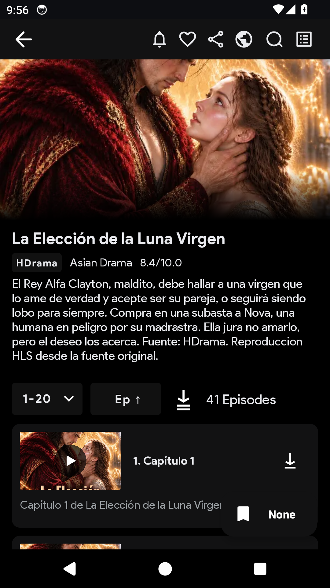
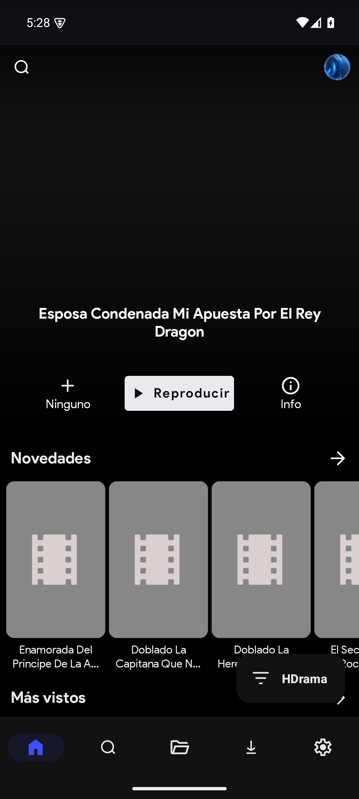
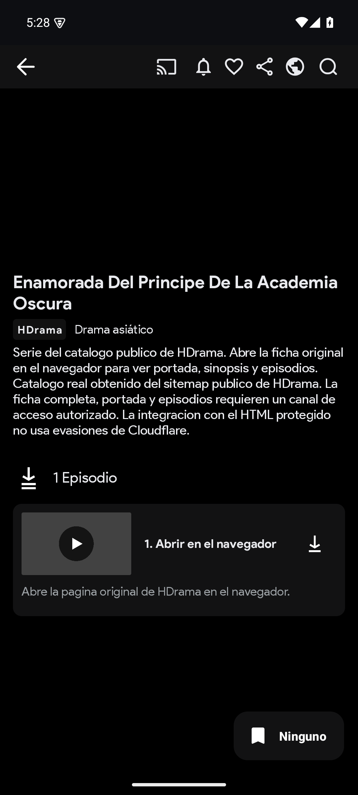
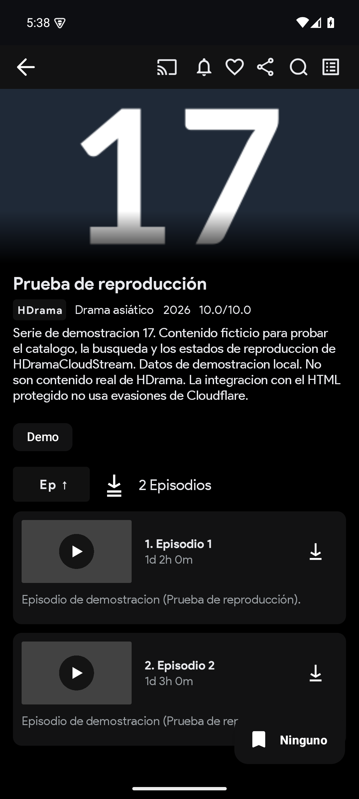

# HDramaCloudStream

Extensión de [CloudStream](https://github.com/recloudstream/cloudstream) para
[es.hdrama.net](https://es.hdrama.net/), escrita en Kotlin.

**Estado:** versión 2 (release v1.1.0), beta. El catálogo, la búsqueda, las
fichas, los episodios y el video HLS se obtienen del sitio real. La sesión de
Cloudflare la resuelve el WebView de CloudStream; si no está disponible, el
plugin usa los sitemaps públicos y fichas de navegación como respaldo.

## Qué funciona

| Función | Estado |
|---|---|
| Plugin `.cs3` y registro del proveedor HDrama | Implementado; carga verificada en CloudStream 4.9.1 |
| Secciones: Destacados, Novedades, Más vistos, Tendencias, Catálogo general, Géneros, Fuentes y Acceso | Implementadas con el HTML real |
| Búsqueda real (`/search?q=`) | Implementada |
| Ficha real: póster, sinopsis, géneros, nota, año y relacionadas | Implementada |
| Lista completa de episodios con duración y número mostrado | Implementada |
| Sesión Cloudflare vía WebView del sistema (`WebViewFetcher`) | Implementada |
| Fuentes de video: HLS directo + proxy espejo | Implementado |
| Descifrado AES-256-GCM del payload `/api/episode-source` | Implementado y probado con vectores |
| Respaldo por sitemaps y fichas de navegación sin sesión | Implementado |
| Catálogo demo con MP4/HLS públicos ("Acceso a HDrama") | Implementado |
| Estados de error diferenciados y mensajes en español | Implementado |
| Subtítulos | Soportados si la fuente los aporta |
| Favoritos, historial, continuar viendo y pantalla completa | Nativos de CloudStream |
| Pruebas unitarias JVM | 98 pruebas unitarias en 16 suites |

## Capturas

Capturas de la verificación de la versión 2 (emulador Android 14 + CloudStream
4.9.1):

| Catálogo real (HTML) | Ficha real con episodios |
|---|---|
|  |  |

Imágenes de la verificación de la versión 1.0.0 (el catálogo se construía
entonces solo con sitemaps); el detalle de pruebas está en
[`Docs/05-pruebas.md`](Docs/05-pruebas.md).

| Catálogo v1 | Ficha v1 |
|---|---|
|  |  |

| Demo con episodios | Reproducción MP4 |
|---|---|
|  |  |

## Cómo funciona

1. CloudStream pide la pantalla principal y el plugin consulta el HTML del
   sitio con la sesión de Cloudflare que gestiona un WebView del sistema
   (`WebViewFetcher`); `CloudflareKiller` queda como respaldo para entornos sin
   contexto Android.
2. El parser extrae JSON-LD y DOM: títulos, pósters, notas, metadatos,
   episodios y relacionadas.
3. Al reproducir un episodio se consulta
   `/api/episode-source/<bookId>/<serial>`, se descifra el payload con
   AES-256-GCM y se emiten las URLs HLS: la directa y un espejo con `Referer`.
4. Si la sesión, la red o los hosts de video fallan, se usa el sitemap público
   (títulos y navegación) y el catálogo demo como último recurso.

## Compilación

Requisitos: Windows/macOS/Linux, JDK 21, Android SDK 35. En el entorno de
desarrollo verificado se usa el JDK de Android Studio y una caché de Gradle
dentro del workspace:

```powershell
$env:JAVA_HOME="C:\Program Files\Android\Android Studio\jbr"  # o cualquier JDK 21
$env:ANDROID_HOME="$env:LOCALAPPDATA\Android\Sdk"
$env:GRADLE_USER_HOME="$PWD\.gradle-home"  # opcional: caché de Gradle dentro del repo

.\gradlew.bat :HDrama:testDebugUnitTest --console=plain
.\gradlew.bat :HDrama:make
.\gradlew.bat makePluginsJson
```

Artefacto: `HDrama/build/HDrama.cs3`
(tamaño: 123.299 bytes (123 KB); SHA-256:
7fbcccb77000ab15ccaa81605b5bc4e11762c9777f83d0f2e62101152e1394e4).

Solo puede ejecutarse una compilación a la vez: crear `.build-lock` antes y
borrarlo después (ver [`Docs/04-compilacion.md`](Docs/04-compilacion.md)).

## Instalación rápida

```powershell
adb install -r 4.9.1.apk
adb shell mkdir -p /sdcard/Cloudstream3/plugins
adb push HDrama.cs3 /sdcard/Cloudstream3/plugins/HDrama.cs3
adb shell appops set com.lagradost.cloudstream3 MANAGE_EXTERNAL_STORAGE allow
adb shell am force-stop com.lagradost.cloudstream3
```

Abrir CloudStream, pulsar el filtro de proveedores y elegir **HDrama**.

Como repositorio de CloudStream (`repo.json` de la rama `builds`):

```text
https://raw.githubusercontent.com/GeorgesGil/HDramaCloudStream/builds/repo.json
```

El repositorio es público desde la v1.1.0, por lo que la URL es instalable
directamente en CloudStream. Procedimiento completo en
[`Docs/06-instalacion.md`](Docs/06-instalacion.md).

## Arquitectura

```text
HDramaProvider (CloudStream MainAPI)
  └── CatalogRepository (prioridad + caché TTL)
       ├── HdramaCatalogAdapter   (HTML real; WebViewFetcher + parser + fuentes HLS)
       ├── SitemapCatalogAdapter  (respaldo: sitemaps públicos)
       ├── DemoCatalogAdapter     (diagnóstico: datos sintéticos + MP4/HLS públicos)
       └── AccessCards / ManualHdramaImport (navegación e importación)
  └── LinkResolver → ExtractorLink (M3U8/VIDEO)
```

- `catalog/`: secciones, rutas reales, adaptadores y repositorio.
- `parser/`: jsoup + JSON-LD, contrato de selectores y fixtures reales.
- `network/`: WebViewFetcher (WebView del sistema), fallback CloudflareKiller, sitemaps, allowlist y caché.
- `sources/`: cifrado AES-256-GCM y cliente de la API de fuentes.
- `models/`: dominio puro, sin tipos de CloudStream.
- `player/`: resolución de HLS/MP4 y estados.
- `utils/`: normalización Unicode, URLs, IDs de episodio y diagnóstico.

Detalle en [`Docs/03-arquitectura.md`](Docs/03-arquitectura.md).

## Limitaciones

- La primera petición puede tardar mientras se resuelve el Cloudflare Managed
  Challenge en el WebView; sin sesión se usa el respaldo por sitemaps.
- Los tokens de video caducan: las fuentes se resuelven al reproducir.
- Los hosts de video y el proxy espejo son de terceros y pueden fallar o
  cambiar.
- El sitio puede cambiar rutas, selectores o la clave de cifrado sin aviso.
- No se ha probado en hardware físico (Galaxy Z Fold8) ni en redes móviles.

Detalle en [`Docs/08-limitaciones.md`](Docs/08-limitaciones.md).

## Documentación

- [Seguimiento](Docs/00-seguimiento.md)
- [Investigación CloudStream](Docs/01-investigacion-cloudstream.md)
- [Investigación HDrama](Docs/02-investigacion-hdrama.md)
- [Arquitectura](Docs/03-arquitectura.md)
- [Compilación](Docs/04-compilacion.md)
- [Pruebas](Docs/05-pruebas.md)
- [Instalación](Docs/06-instalacion.md)
- [Privacidad](Docs/07-privacidad.md)
- [Limitaciones](Docs/08-limitaciones.md)
- [Informe final](Docs/09-informe-final.md)

## Licencia

GNU General Public License v3.0 (ver [`LICENSE`](LICENSE)). CloudStream y sus
herramientas conservan sus licencias originales.
